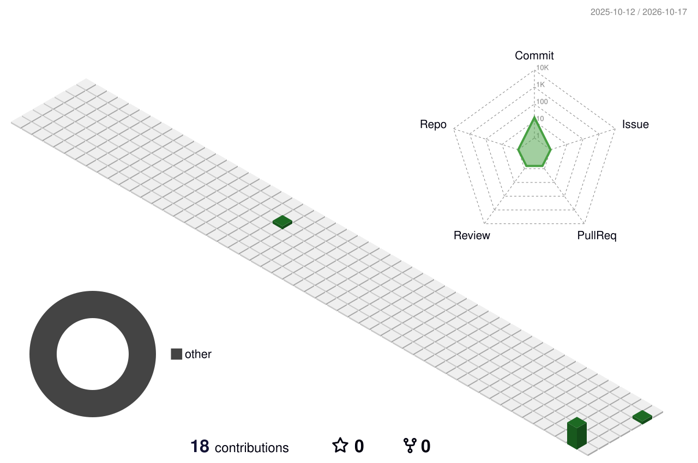

### 🐍 我的贡献被吃掉了

<picture>
  <source media="(prefers-color-scheme: dark)" srcset="profile-snake-contrib/github-contribution-grid-snake-dark.svg" />
  <source media="(prefers-color-scheme: light)" srcset="profile-snake-contrib/github-contribution-grid-snake.svg" />
  
</picture>

---

### Hi there 👋

我是 **shawn**，一名光通信行业的嵌入式固件工程师。

- 🔧 技术与平台：ARM · MCU · SoC · RISC · FreeRTOS · RT-Thread · TI-RTOS
- 🌱 正在啃：MicroBlaze · 相干 OTDR / OCM
- 📫 找我：shbao@outlook.com

> 代码跑在硅片上，信号跑在光纤里。
>
> **Code runs on silicon, light runs through fiber.**

---

### 💼 工作内容

- 基于 Cortex-M4 / M33 的 RT-Thread 嵌入式开发
- 基于易灵思（Efinix）软核的小型可插拔 OTDR 模块嵌入式软件开发
- 基于 Xilinx MicroBlaze 的驱动开发
- OTDR 事件定位算法设计与仿真
- 应用于 OCM 的 DMA 控制与采集系统开发
- 其他光通信模块的软件设计
- 闲时写一写测试 GUI 和脚本

---

### 📈 GitHub 统计

  

  

展开更多数据

 

  

  

  

  

  

  

  

---

### 🏔️ 3D 贡献图

  

